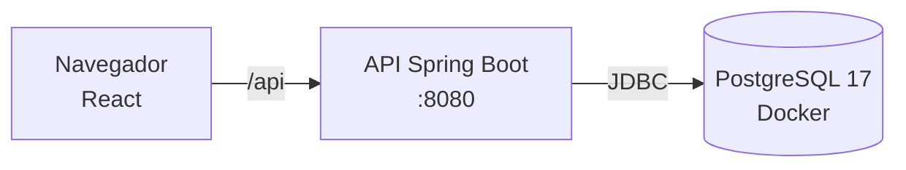

# Locadora de Filmes

Sistema web de locadora: cadastros, aluguel, devolução com multa e relatórios.
Trabalho de **Banco de Dados II** (UFVJM, 2026/2) — o foco é mostrar programação em banco
de dados: conexão, consultas, junções, transações, stored procedure e CRUD.


## Sumário

- [Visão geral](#visão-geral)
- [Pré-requisitos](#pré-requisitos)
- [Início rápido: modo Docker](#início-rápido-modo-docker)
- [Início rápido: modo desenvolvimento](#início-rápido-modo-desenvolvimento)
- [Configuração](#configuração)
- [Como usar](#como-usar)
- [Estrutura de pastas](#estrutura-de-pastas)
- [Documentação](#documentação)
- [Solução de problemas](#solução-de-problemas)
- [Entrega](#entrega)
- [Autores](#autores)

## Visão geral

- Login de funcionários (perfis `ADMIN` e `ATENDENTE`) com sessão em cookie e proteção CSRF.
- Cadastro de filmes, atores, elenco, exemplares, clientes e funcionários.
- **Aluguel** em transação: trava o exemplar, grava o aluguel e marca o exemplar como alugado.
- **Devolução** pela stored procedure `sp_registrar_devolucao`, que calcula a multa no banco.
- Histórico de aluguéis e relatórios (faturamento, exemplares por filme, elenco), todos com junções.



No modo Docker, a API também serve o frontend já compilado (tudo em `:8080`). No modo
desenvolvimento, o Vite (`:5173`) serve o React e repassa `/api` para a API.

## Pré-requisitos

**Modo Docker** (o mais simples — só precisa de Docker):

| Ferramenta | Versão | Como verificar |
|---|---|---|
| Docker (com Compose v2) | 24 ou mais novo | `docker --version` e `docker compose version` |

**Modo desenvolvimento** (Docker só para o banco):

| Ferramenta | Versão | Como verificar |
|---|---|---|
| Docker (com Compose v2) | 24 ou mais novo | `docker compose version` |
| JDK | 25 | `java -version` |
| Node.js | 22 ou mais novo | `node -v` |

O Maven vem junto do projeto (`mvnw`); não precisa instalar.

## Início rápido: modo Docker

Sobe banco, API e frontend com um comando.

1. Crie o arquivo `.env` a partir do exemplo:

   ```bash
   cp .env.example .env
   ```

   ```powershell
   Copy-Item .env.example .env
   ```

2. Abra o `.env` e escreva uma senha em `DB_PASSWORD` (vem vazia de propósito: sem ela o
   `docker compose` não sobe). Não mexa no resto.

3. Suba tudo (a primeira vez baixa imagens e compila o projeto; leva alguns minutos):

   ```bash
   docker compose --profile app up -d --build
   ```

   Você deve ver `Container locadora-app-1 Started`.

4. Confira se os dois serviços estão saudáveis:

   ```bash
   docker compose ps
   ```

   Você deve ver `locadora-postgres` e `locadora-app-1` com status `healthy`
   (o `app` leva cerca de 40 s).

5. Abra <http://localhost:8080> e entre com um dos [usuários de demonstração](#como-usar).

Para parar:

```bash
docker compose --profile app down        # para os containers e mantém os dados
docker compose --profile app down -v     # para e APAGA o banco (volume locadora_pgdata)
```

> [!NOTE]
> O container roda com o perfil Spring `dev`: carrega os dados de demonstração e mostra o
> SQL no log (`docker compose logs -f app`). Veja `SPRING_PROFILES_ACTIVE` em
> [Configuração](#configuração).

## Início rápido: modo desenvolvimento

Para editar o código com recarga rápida. Só o banco roda no Docker.

1. Crie o `.env` e defina `DB_PASSWORD` (passos 1 e 2 do modo Docker).

2. Suba só o PostgreSQL:

   ```bash
   docker compose up -d
   ```

   Você deve ver `locadora-postgres` com status `healthy` em `docker compose ps`.
   O banco fica em `localhost:55432`.

3. Carregue as variáveis do `.env` no terminal e inicie a API (em `backend/`):

   ```bash
   set -a; . ./.env; set +a
   cd backend
   ./mvnw -q spring-boot:run -Dspring-boot.run.profiles=dev
   ```

   ```powershell
   Get-Content .env | Where-Object { $_ -match '^\s*[^#\s][^=]*=' } | ForEach-Object {
     $k, $v = $_ -split '=', 2; Set-Item "Env:$($k.Trim())" $v
   }
   cd backend
   .\mvnw.cmd -q spring-boot:run "-Dspring-boot.run.profiles=dev"
   ```

   Você deve ver `Started LocadoraApplication` e o Flyway aplicando as migrations.

4. Em **outro terminal**, inicie o frontend:

   ```bash
   cd frontend
   npm install
   npm run dev
   ```

   Você deve ver `Local: http://localhost:5173/`.

5. Abra <http://localhost:5173>.

> [!WARNING]
> Rode o `mvnw` dentro de `backend/`: o seed de demonstração é lido de `../db/seed`,
> relativo ao diretório de trabalho do processo.

Testes do backend (Testcontainers; exige Docker rodando): `cd backend && ./mvnw -q verify`.

## Configuração

Todas as variáveis ficam no `.env` (fora do git). Nada de senha em código.

| Nome | Para que serve | Exemplo |
|---|---|---|
| `DB_NAME` | Nome do banco criado pelo PostgreSQL | `locadora` |
| `DB_USER` | Usuário do banco | `locadora` |
| `DB_PASSWORD` | Senha do banco (**obrigatória**) | `uma-senha-sua` |
| `DB_URL` | URL JDBC usada pela API no modo desenvolvimento | `jdbc:postgresql://localhost:55432/locadora?escapeSyntaxCallMode=callIfNoReturn` |
| `SPRING_PROFILES_ACTIVE` | Perfil do container: `dev` (padrão) tem seed e login por `http://`; outro valor roda só as migrations e exige HTTPS | `dev` |

No modo Docker o `DB_URL` do `.env` é ignorado: o `docker-compose.yml` monta a URL com o host
`db`, porque dentro do container `localhost` é o próprio container.

## Como usar

Usuários de demonstração (**só para desenvolvimento**; vêm do seed `db/seed/R__dados_demo.sql`):

| Perfil | Email | Senha |
|---|---|---|
| ADMIN | `carlos@locadora.com` | `admin123` |
| ATENDENTE | `fernanda@locadora.com` | `func123` |

Roteiro curto de demonstração:

1. Entre como **ADMIN** e abra **Filmes**: veja o detalhe de um filme com exemplares e elenco.
2. **Novo aluguel**: escolha filme → exemplar disponível → cliente → confirme.
   O aluguel é uma transação com lock no exemplar.
3. **Devoluções**: registre a devolução de um aluguel em atraso. A multa (R$ 2,00 por dia)
   vem da stored procedure.
4. **Histórico**: filtre por cliente e por "só em aberto".
5. **Relatórios** (só ADMIN): faturamento por funcionário, exemplares por filme, filmes com
   mais de um ator.
6. Tente excluir um cliente que já alugou: o banco recusa (FK) e a tela mostra o erro 409.
7. Mostre o SQL ao vivo: `docker compose logs -f app` (modo Docker) ou o console do `mvnw`.

## Estrutura de pastas

```text
.
├── docker-compose.yml     PostgreSQL (sempre) e app completo (profile "app")
├── .env.example           modelo do .env
├── backend/               API Spring Boot (Maven wrapper) → backend/README.md
│   └── src/main/resources/db/migration/   V1 (BD1), V2 (ajustes), V3 (stored procedure)
├── frontend/              React + Vite + TypeScript → frontend/README.md
├── db/seed/               dados de demonstração (só perfil dev)
└── docs/
    ├── BANCO_DE_DADOS.md  guia da apresentação: onde está cada SQL no código
    └── REQUISITOS.md      requisitos funcionais e regras de negócio
```

## Documentação

- [`backend/README.md`](backend/README.md) — API, endpoints, perfis e testes.
- [`frontend/README.md`](frontend/README.md) — telas, rotas e responsividade.
- [`docs/BANCO_DE_DADOS.md`](docs/BANCO_DE_DADOS.md) — conexão, migrations, mapa JPA → SQL,
  transações, stored procedure e junções. O
  [checklist do roteiro](docs/BANCO_DE_DADOS.md#1-checklist-do-roteiro) aponta cada item.
- [`docs/REQUISITOS.md`](docs/REQUISITOS.md) — requisitos funcionais.

Todo trecho de código ligado ao roteiro tem a marca `[ROTEIRO-xx]`. Para listar:

```bash
git grep -n "\[ROTEIRO" -- backend db docker-compose.yml .env.example
```

## Solução de problemas

<details>
<summary>"Cannot connect to the Docker daemon" ou "docker: command not found"</summary>

O Docker não está rodando (ou não está instalado). Abra o Docker Desktop, espere o ícone
indicar que está pronto e repita o comando.
</details>

<details>
<summary>"defina DB_PASSWORD no .env" ao subir o compose</summary>

O `.env` não existe ou está com `DB_PASSWORD` vazio. Copie o `.env.example` para `.env` e
escreva uma senha.
</details>

<details>
<summary>Porta ocupada (8080 ou 55432)</summary>

Outro programa usa a porta. Feche-o, ou rode `docker compose --profile app down` se for uma
subida anterior deste projeto. O banco usa `55432` (e não a `5432` padrão) justamente para
não colidir com um PostgreSQL instalado na máquina.
</details>

<details>
<summary>Flyway: "Migration checksum mismatch"</summary>

Alguém editou uma migration já aplicada (`V1`, `V2`, `V3`). Nunca edite: crie uma nova
(`V4`…). Em desenvolvimento, para recomeçar do zero e **perder os dados locais**:

```bash
docker compose --profile app down -v
docker compose up -d
```
</details>

<details>
<summary>Login responde 403 ("Token CSRF ausente ou inválido")</summary>

O app e a API precisam estar na **mesma origem**. Acesse por <http://localhost:8080> (Docker)
ou <http://localhost:5173> (Vite, que faz o proxy); não chame a porta 8080 direto de uma página
aberta em outra porta.
</details>

<details>
<summary>Entro, mas a sessão "não pega" (volto para o login)</summary>

Com `SPRING_PROFILES_ACTIVE` diferente de `dev` o cookie de sessão é `Secure` e o navegador
só o aceita por HTTPS. Use `dev` para testar em `http://localhost`.
</details>

## Entrega

Para gerar o pacote do Classroom (código + migrations, que são as "estruturas do banco"):

```bash
git archive --format=zip -o NOME_DO_GRUPO.zip HEAD
```

## Autores

- João Marcos Campelo
- Vitor Fagundes
- Isabella Baracho
- Catarina Cotta Lannes
- Dayvid Eduardo
