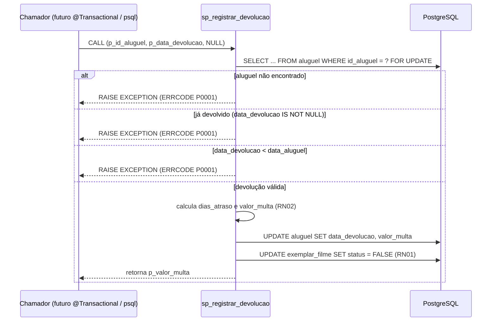

# Programação em Banco de Dados — como a Locadora conversa com o PostgreSQL

> Documento vivo: o Claude Code atualiza este arquivo a cada tarefa que toca o banco
> (skill `roteiro-bd2`). É o guia da apresentação: cada seção mostra **onde está no
> código** e **qual SQL é executado**.

## Sumário

1. [Checklist do roteiro](#1-checklist-do-roteiro)
2. [Conexão com a base](#2-conexão-com-a-base)
3. [Migrations (Flyway)](#3-migrations-flyway)
4. [Mapa de abstrações: do Java ao SQL](#4-mapa-de-abstrações-do-java-ao-sql)
5. [Transações](#5-transações)
6. [Stored procedure](#6-stored-procedure)
7. [Consultas com junção](#7-consultas-com-junção)
8. [Como ver o SQL gerado ao vivo](#8-como-ver-o-sql-gerado-ao-vivo)

## 1. Checklist do roteiro

| Item | Onde | Marca no código |
|---|---|---|
| 1c Conexão | `docker-compose.yml`, `backend/src/main/resources/application.yml`, `application-dev.yml` | `[ROTEIRO-1c-CONEXAO]` |
| 1c Consultas e procedures | Consulta de login: `FuncionarioRepository.findByEmail` e `FuncionarioUserDetailsService` (seção 4). Procedure: _a preencher_ | `[ROTEIRO-1c-CONSULTA]`, `[ROTEIRO-1c-PROCEDURE]` |
| 2a Transações | _a preencher_ | `[ROTEIRO-2a-TRANSACAO]` |
| 2b Junção | _a preencher_ | `[ROTEIRO-2b-JUNCAO]` |
| 2c Stored procedure com parâmetro | _a preencher_ | `[ROTEIRO-2c-PROCEDURE]` |
| 2d SELECT / INSERT / UPDATE / DELETE | _a preencher_ | `[ROTEIRO-2d-*]` |
| Mapeamento do framework | seção 4 | `[ROTEIRO-FW-MAPEAMENTO]` |

Para listar todos os pontos: `grep -rn "\[ROTEIRO" backend/ docker-compose.yml`

## 2. Conexão com a base

A cadeia de conexão tem quatro elos, cada um passando a configuração para o próximo:

1. **`.env`** (raiz, fora do git) define `DB_NAME`, `DB_USER`, `DB_PASSWORD` e `DB_URL`
   — a URL JDBC já inclui `escapeSyntaxCallMode=callIfNoReturn`, necessário para o
   `CALL` de stored procedure via JDBC (ver seção 6 e skill `roteiro-bd2`).
2. **`docker-compose.yml`** (`[ROTEIRO-1c-CONEXAO]`) sobe o PostgreSQL 17 lendo
   `DB_NAME`/`DB_USER`/`DB_PASSWORD` do `.env` e publica a porta em `127.0.0.1:55432`
   (não a 5432 padrão, para não conflitar com um Postgres local).
3. **`backend/src/main/resources/application.yml`** (`[ROTEIRO-1c-CONEXAO]`) lê
   `DB_URL`, `DB_USER` e `DB_PASSWORD` do ambiente do processo Java — **sem valor
   padrão**:
   ```yaml
   spring:
     datasource:
       url: ${DB_URL}
       username: ${DB_USER}
       password: ${DB_PASSWORD}
   ```
   Se qualquer uma faltar, o Spring falha ao iniciar (fail fast) em vez de arriscar
   conectar no banco errado ou sem senha.
4. O **HikariCP** (pool padrão do Spring Boot) abre as conexões reais com essa URL; o
   **Flyway** usa o mesmo `DataSource` para aplicar `V1`, `V2`, `V3` — e, só no perfil
   `dev`, também `R__dados_demo.sql` — antes de qualquer bean que dependa do banco ser
   criado. É por isso que `spring.jpa.hibernate.ddl-auto=validate` sempre encontra o
   schema já pronto: o Hibernate nunca cria tabela, só confere.

`spring.jpa.open-in-view=false` fecha a conexão ao final do service, não ao final da
resposta HTTP — evita conexão aberta durante serialização e lazy-loading escondido na
camada web (que viraria N+1 silencioso).

**Como rodar:** `docker compose up -d` sobe o banco; em `backend/`, `./mvnw
spring-boot:run -Dspring-boot.run.profiles=dev` herda as variáveis do `.env` do
processo (exporte-as no shell ou configure-as na run configuration da IDE) e conecta.

**Cuidado com o perfil dev:** `application-dev.yml` aponta
`spring.flyway.locations: classpath:db/migration,filesystem:../db/seed`. O prefixo
`filesystem:` é resolvido a partir do diretório de trabalho do processo Java, não do
classpath — como o Maven roda com `cwd=backend/`, `../db/seed` chega ao `db/seed` da
raiz do repositório. Se a IDE rodar com outro diretório de trabalho, ajuste-o para
`backend/`. Testado via `./mvnw spring-boot:run -Dspring-boot.run.profiles=dev`: o log
mostra a 4ª migration (`"dados demo"`, repeatable) aplicada depois de V1-V3.

## 3. Migrations (Flyway)

| Versão | Arquivo | O que faz |
|---|---|---|
| V1 | `backend/src/main/resources/db/migration/V1__schema_bd1.sql` | Recria o schema original do BD1: 6 tabelas e 6 FKs, sem alterações. |
| V2 | `backend/src/main/resources/db/migration/V2__ajustes_bd2.sql` | Ajustes do BD2: `senha` em BCrypt (`VARCHAR(100)`), coluna `perfil` (ADMIN/ATENDENTE), `aluguel.data_devolucao`, CHECKs de RN04, índices em todas as FKs, `ON DELETE CASCADE` só em `filme_ator`, comentário em `exemplar_filme.status`. |
| V3 | `backend/src/main/resources/db/migration/V3__procedures.sql` | Stored procedure `sp_registrar_devolucao` (RF08, RN02): devolução + cálculo de multa, atômica, com `SELECT ... FOR UPDATE`. |
| R\_\_ (repeatable, só perfil `dev`) | `db/seed/R__dados_demo.sql` | Dados de demonstração do BD1 + 2 funcionários com senha em BCrypt via `pgcrypto`. Idempotente (`TRUNCATE ... RESTART IDENTITY CASCADE`). |

## 4. Mapa de abstrações: do Java ao SQL

| Método / anotação | Arquivo | SQL executado (copiado do log) | Roteiro |
|---|---|---|---|
| `FuncionarioRepository.findByEmail(email)` — query derivada, chamada no login por `FuncionarioUserDetailsService.loadUserByUsername` (RF01) | `FuncionarioRepository.java:11`, `FuncionarioUserDetailsService.java:27` | `select f1_0.id_funcionario,f1_0.bairro,f1_0.cidade,f1_0.email,f1_0.perfil,f1_0.primeiro_nome,f1_0.rua,f1_0.senha,f1_0.sobrenome,f1_0.telefone from funcionario f1_0 where f1_0.email=?` | `[ROTEIRO-1c-CONSULTA]` `[ROTEIRO-FW-MAPEAMENTO]` |

Depois do SELECT, o hash BCrypt de `senha` é comparado com a senha digitada pelo
`BCryptPasswordEncoder` (no Java, não no banco). Email inexistente e senha errada geram a
mesma resposta 401 "Credenciais inválidas".

## 5. Transações

## 6. Stored procedure

`sp_registrar_devolucao` implementa RF08 (registrar devolução) e atende o item 2c do
roteiro (stored procedure com parâmetro). Definida em
`backend/src/main/resources/db/migration/V3__procedures.sql`.

**Assinatura:**

```sql
CREATE OR REPLACE PROCEDURE sp_registrar_devolucao(
    IN    p_id_aluguel     INT,
    IN    p_data_devolucao DATE,
    INOUT p_valor_multa    NUMERIC
)
```

| Parâmetro | Direção | Significado |
|---|---|---|
| `p_id_aluguel` | IN | Aluguel a ser devolvido. |
| `p_data_devolucao` | IN | Data em que o cliente devolveu o exemplar. |
| `p_valor_multa` | INOUT | Entra vazio; a procedure calcula e devolve o valor da multa. |

**Regra de multa (RN02):** `dias_atraso = GREATEST(0, p_data_devolucao - data_entrega)`;
`valor_multa = dias_atraso × R$ 2,00`. Sem atraso, multa é `0`.

**Fluxo (transação atômica):**



**Erros:** todos os caminhos de regra de negócio usam `RAISE EXCEPTION ... USING ERRCODE
= 'P0001'` (aluguel inexistente, já devolvido, ou data de devolução anterior à do
aluguel — essa última guarda evita que o CHECK `ck_aluguel_devolucao_data` do V2
devolva um SQLSTATE diferente). Na Fase 4b, o Java converte `P0001` em HTTP 422.

**Por que é chamada assim:** sem `COMMIT` interno, pois a procedure roda dentro da
transação do chamador (o futuro service `@Transactional`); o `SELECT ... FOR UPDATE`
trava a linha do aluguel contra devolução concorrente do mesmo registro. Também pode
ser testada isoladamente via `psql` (`CALL sp_registrar_devolucao(2, '2026-06-20',
NULL);`), já que cada `CALL` de topo no `psql` autocommita.

## 7. Consultas com junção

## 8. Como ver o SQL gerado ao vivo

O perfil `dev` (`application-dev.yml`) liga dois loggers do Hibernate:

```yaml
logging:
  level:
    org.hibernate.SQL: DEBUG
    org.hibernate.orm.jdbc.bind: TRACE
```

- `org.hibernate.SQL=DEBUG` imprime o SQL gerado, com `?` no lugar dos parâmetros.
- `org.hibernate.orm.jdbc.bind=TRACE` imprime o valor real de cada `?`, na ordem.

Para apresentar: `cd backend && ./mvnw spring-boot:run -Dspring-boot.run.profiles=dev`
e acompanhe o console. Cada chamada a um método de repository (`save`, `findById`,
`findAll`, `deleteById`...) imprime o `SELECT`/`INSERT`/`UPDATE`/`DELETE`
correspondente — esse log é a fonte da tabela da seção 4 (Mapa de abstrações): copie o
SQL real de lá, não invente.

**Nunca** ligue esses loggers no perfil padrão: são verbosos e podem expor dados
sensíveis no bind de parâmetro (ex.: o hash de `funcionario.senha`) no log de
produção.
