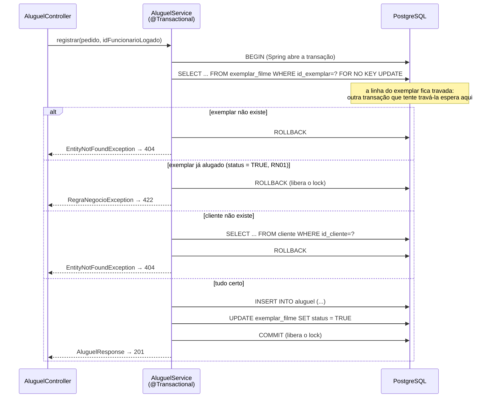
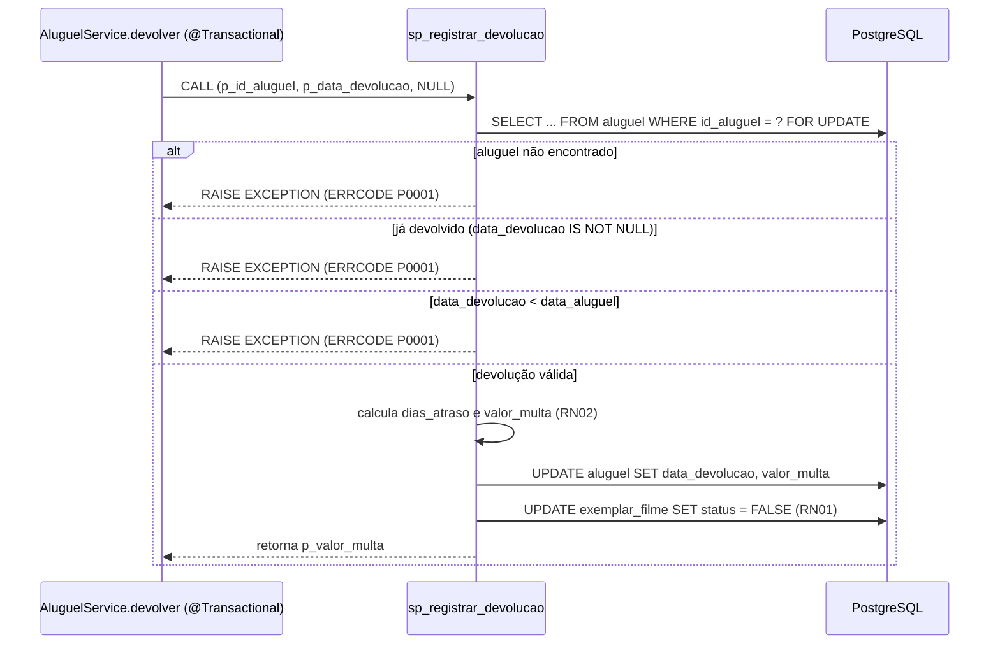

# Programação em Banco de Dados — como a Locadora conversa com o PostgreSQL

> Documento vivo: o Claude Code atualiza este arquivo a cada tarefa que toca o banco
> (skill `roteiro-bd2`). É o guia da apresentação: cada seção mostra **onde está no
> código** e **qual SQL é executado**.

## Sumário

1. [Checklist do roteiro](#1-checklist-do-roteiro)
2. [Conexão com a base](#2-conexão-com-a-base)
3. [Migrations (Flyway)](#3-migrations-flyway)
4. [Mapa de abstrações: do Java ao SQL](#4-mapa-de-abstrações-do-java-ao-sql)
5. [Transações](#5-transações)
6. [Stored procedure](#6-stored-procedure)
7. [Consultas com junção](#7-consultas-com-junção)
8. [Como ver o SQL gerado ao vivo](#8-como-ver-o-sql-gerado-ao-vivo)

## 1. Checklist do roteiro

| Item | Onde | Marca no código |
|---|---|---|
| 1c Conexão | `docker-compose.yml`, `backend/src/main/resources/application.yml`, `application-dev.yml` | `[ROTEIRO-1c-CONEXAO]` |
| 1c Consultas e procedures | Consulta de login: `FuncionarioRepository.findByEmail` e `FuncionarioUserDetailsService` (seção 4). Procedure e relatórios: seções 6 e 7 | `[ROTEIRO-1c-CONSULTA]`, `[ROTEIRO-1c-PROCEDURE]` |
| 2a Transações | `AluguelService.registrar` (`@Transactional` + lock) e `AluguelService.devolver` — seção 5 | `[ROTEIRO-2a-TRANSACAO]` |
| 2b Junção | Elenco do filme: `FilmeAtorRepository.findElencoByFilme` (seção 4); histórico e relatórios: seção 7 | `[ROTEIRO-2b-JUNCAO]` |
| 2c Stored procedure com parâmetro | `V3__procedures.sql` + `AluguelService.devolver` — seção 6 | `[ROTEIRO-2c-PROCEDURE]` |
| 2d SELECT / INSERT / UPDATE / DELETE | `FilmeService` (criar, listar, atualizar, excluir) e `ElencoService` — seção 4 | `[ROTEIRO-2d-*]` |
| Mapeamento do framework | seção 4 | `[ROTEIRO-FW-MAPEAMENTO]` |

Para listar todos os pontos: `grep -rn "\[ROTEIRO" backend/ docker-compose.yml`

## 2. Conexão com a base

A cadeia de conexão tem quatro elos, cada um passando a configuração para o próximo:

1. **`.env`** (raiz, fora do git) define `DB_NAME`, `DB_USER`, `DB_PASSWORD` e `DB_URL`
   — a URL JDBC já inclui `escapeSyntaxCallMode=callIfNoReturn`, necessário para o
   `CALL` de stored procedure via JDBC (ver seção 6 e skill `roteiro-bd2`).
2. **`docker-compose.yml`** (`[ROTEIRO-1c-CONEXAO]`) sobe o PostgreSQL 17 lendo
   `DB_NAME`/`DB_USER`/`DB_PASSWORD` do `.env` e publica a porta em `127.0.0.1:55432`
   (não a 5432 padrão, para não conflitar com um Postgres local).
3. **`backend/src/main/resources/application.yml`** (`[ROTEIRO-1c-CONEXAO]`) lê
   `DB_URL`, `DB_USER` e `DB_PASSWORD` do ambiente do processo Java — **sem valor
   padrão**:
   ```yaml
   spring:
     datasource:
       url: ${DB_URL}
       username: ${DB_USER}
       password: ${DB_PASSWORD}
   ```
   Se qualquer uma faltar, o Spring falha ao iniciar (fail fast) em vez de arriscar
   conectar no banco errado ou sem senha.
4. O **HikariCP** (pool padrão do Spring Boot) abre as conexões reais com essa URL; o
   **Flyway** usa o mesmo `DataSource` para aplicar `V1`, `V2`, `V3` — e, só no perfil
   `dev`, também `R__dados_demo.sql` — antes de qualquer bean que dependa do banco ser
   criado. É por isso que `spring.jpa.hibernate.ddl-auto=validate` sempre encontra o
   schema já pronto: o Hibernate nunca cria tabela, só confere.

`spring.jpa.open-in-view=false` fecha a conexão ao final do service, não ao final da
resposta HTTP — evita conexão aberta durante serialização e lazy-loading escondido na
camada web (que viraria N+1 silencioso).

**Como rodar:** `docker compose up -d` sobe o banco; em `backend/`, `./mvnw
spring-boot:run -Dspring-boot.run.profiles=dev` herda as variáveis do `.env` do
processo (exporte-as no shell ou configure-as na run configuration da IDE) e conecta.

**Cuidado com o perfil dev:** `application-dev.yml` aponta
`spring.flyway.locations: classpath:db/migration,filesystem:../db/seed`. O prefixo
`filesystem:` é resolvido a partir do diretório de trabalho do processo Java, não do
classpath — como o Maven roda com `cwd=backend/`, `../db/seed` chega ao `db/seed` da
raiz do repositório. Se a IDE rodar com outro diretório de trabalho, ajuste-o para
`backend/`. Testado via `./mvnw spring-boot:run -Dspring-boot.run.profiles=dev`: o log
mostra a 4ª migration (`"dados demo"`, repeatable) aplicada depois de V1-V3.

## 3. Migrations (Flyway)

| Versão | Arquivo | O que faz |
|---|---|---|
| V1 | `backend/src/main/resources/db/migration/V1__schema_bd1.sql` | Recria o schema original do BD1: 6 tabelas e 6 FKs, sem alterações. |
| V2 | `backend/src/main/resources/db/migration/V2__ajustes_bd2.sql` | Ajustes do BD2: `senha` em BCrypt (`VARCHAR(100)`), coluna `perfil` (ADMIN/ATENDENTE), `aluguel.data_devolucao`, CHECKs de RN04, índices em todas as FKs, `ON DELETE CASCADE` só em `filme_ator`, comentário em `exemplar_filme.status`. |
| V3 | `backend/src/main/resources/db/migration/V3__procedures.sql` | Stored procedure `sp_registrar_devolucao` (RF08, RN02): devolução + cálculo de multa, atômica, com `SELECT ... FOR UPDATE`. |
| R\_\_ (repeatable, só perfil `dev`) | `db/seed/R__dados_demo.sql` | Dados de demonstração do BD1 + 2 funcionários com senha em BCrypt via `pgcrypto`. Idempotente (`TRUNCATE ... RESTART IDENTITY CASCADE`). |

## 4. Mapa de abstrações: do Java ao SQL

| Método / anotação | Arquivo | SQL executado (copiado do log) | Roteiro |
|---|---|---|---|
| `FuncionarioRepository.findByEmail(email)` — query derivada, chamada no login por `FuncionarioUserDetailsService.loadUserByUsername` (RF01) | `FuncionarioRepository.java:11`, `FuncionarioUserDetailsService.java:27` | `select f1_0.id_funcionario,f1_0.bairro,f1_0.cidade,f1_0.email,f1_0.perfil,f1_0.primeiro_nome,f1_0.rua,f1_0.senha,f1_0.sobrenome,f1_0.telefone from funcionario f1_0 where f1_0.email=?` | `[ROTEIRO-1c-CONSULTA]` `[ROTEIRO-FW-MAPEAMENTO]` |
| `FuncionarioRepository.findCredenciaisById(id)` — query derivada **com projeção** (`FuncionarioCredenciais`): revalida a sessão a cada requisição autenticada (`SessaoRevalidacaoFilter`) | `FuncionarioRepository.java:17`, `SessaoRevalidacaoFilter.java:46` | `select f1_0.perfil,f1_0.senha from funcionario f1_0 where f1_0.id_funcionario=?` (só 2 colunas; vazio = conta excluída) | `[ROTEIRO-1c-CONSULTA]` `[ROTEIRO-FW-MAPEAMENTO]` |
| `FilmeRepository.save(filme)` com id nulo — `FilmeService.criar` (RF02) | `FilmeService.java:43` | `insert into filme (data_lancamento,descricao,duracao_minutos,nome) values (?,?,?,?)` | `[ROTEIRO-FW-MAPEAMENTO]` `[ROTEIRO-2d-INSERT]` |
| `FilmeRepository.findAll(pageable)` — `FilmeService.listar` | `FilmeService.java:26` | `select f1_0.id_filme,f1_0.data_lancamento,f1_0.descricao,f1_0.duracao_minutos,f1_0.nome from filme f1_0 order by f1_0.id_filme offset ? rows fetch first ? rows only` + `select count(f1_0.id_filme) from filme f1_0` (o `count` só roda quando a página vem cheia) | `[ROTEIRO-FW-MAPEAMENTO]` `[ROTEIRO-2d-SELECT]` |
| `FilmeRepository.findByNomeContainingIgnoreCase(nome, pageable)` — query derivada da busca `?nome=` | `FilmeRepository.java:12`, chamada em `FilmeService.java:28` | `select f1_0.id_filme,... from filme f1_0 where upper(f1_0.nome) like upper(?) escape '\' order by f1_0.id_filme fetch first ? rows only` (bind: `%matr%`) | `[ROTEIRO-FW-MAPEAMENTO]` |
| `FilmeRepository.findById(id)` — `FilmeService.obter`, base de GET, PUT e DELETE | `FilmeService.java:67` | `select f1_0.id_filme,f1_0.data_lancamento,f1_0.descricao,f1_0.duracao_minutos,f1_0.nome from filme f1_0 where f1_0.id_filme=?` | `[ROTEIRO-FW-MAPEAMENTO]` `[ROTEIRO-2d-SELECT]` |
| **Dirty checking** — `FilmeService.atualizar` (RF02): carrega com `findById`, muda os setters, **não chama `save()`**; o UPDATE sai no COMMIT | `FilmeService.java:53` | `update filme set data_lancamento=?,descricao=?,duracao_minutos=?,nome=? where id_filme=?` (precedido do `select ... where f1_0.id_filme=?` do `findById`) | `[ROTEIRO-FW-MAPEAMENTO]` `[ROTEIRO-2d-UPDATE]` |
| `FilmeRepository.delete(filme)` — `FilmeService.excluir` | `FilmeService.java:63` | `delete from filme where id_filme=?` (`filme_ator` some pelo `ON DELETE CASCADE` do V2; filme com exemplares → erro de FK → 409) | `[ROTEIRO-FW-MAPEAMENTO]` `[ROTEIRO-2d-DELETE]` |
| `FilmeAtorRepository.existsById(id)` — `ElencoService.vincular`/`desvincular` (RF03) | `ElencoService.java:44`, `:61` | `select count(*) from filme_ator fa1_0 where (fa1_0.id_ator,fa1_0.id_filme)=(?,?)` | `[ROTEIRO-FW-MAPEAMENTO]` `[ROTEIRO-2d-SELECT]` |
| `FilmeAtorRepository.save(vinculo)` — vincular ator a filme. Chave composta já preenchida → Spring Data faz `merge()`: confere antes, depois insere | `ElencoService.java:55` | `select fa1_0.id_ator,fa1_0.id_filme from filme_ator fa1_0 where (fa1_0.id_ator,fa1_0.id_filme) in ((?,?))` → `insert into filme_ator (id_ator,id_filme) values (?,?)` | `[ROTEIRO-FW-MAPEAMENTO]` `[ROTEIRO-2d-INSERT]` |
| `FilmeAtorRepository.deleteById(id)` — desvincular | `ElencoService.java:67` | `select fa1_0.id_ator,fa1_0.id_filme from filme_ator fa1_0 where (fa1_0.id_ator,fa1_0.id_filme) in ((?,?))` → `delete from filme_ator where id_ator=? and id_filme=?` | `[ROTEIRO-FW-MAPEAMENTO]` `[ROTEIRO-2d-DELETE]` |
| `FilmeAtorRepository.findElencoByFilme(idFilme)` — `@Query` JPQL com **JOIN** (elenco do filme, `GET /api/filmes/{id}/atores`) | `FilmeAtorRepository.java:19` (JPQL em `:15-18`) | `select a1_0.id_ator,a1_0.primeiro_nome,a1_0.sobrenome from filme_ator fa1_0 join ator a1_0 on a1_0.id_ator=fa1_0.id_ator where fa1_0.id_filme=? order by a1_0.primeiro_nome,a1_0.sobrenome,a1_0.id_ator` | `[ROTEIRO-2b-JUNCAO]` |
| `ClienteRepository.findByPrimeiroNomeContainingIgnoreCaseOrSobrenomeContainingIgnoreCase` — busca `?nome=` de clientes (RF05) | `ClienteRepository.java:12`, chamada em `ClienteService.java:29` | `select c1_0.id_cliente,c1_0.bairro,c1_0.cidade,c1_0.email,c1_0.primeiro_nome,c1_0.rua,c1_0.sobrenome,c1_0.telefone from cliente c1_0 where upper(c1_0.primeiro_nome) like upper(?) escape '\' or upper(c1_0.sobrenome) like upper(?) escape '\' order by c1_0.id_cliente fetch first ? rows only` | `[ROTEIRO-FW-MAPEAMENTO]` |
| `ClienteRepository.delete(cliente)` — `ClienteService.excluir`. Cliente com aluguéis → **409** (RN03) | `ClienteService.java:53` | `delete from cliente where id_cliente=?` (o PostgreSQL recusa pela FK `fk_aluguel_cliente`) | `[ROTEIRO-FW-MAPEAMENTO]` `[ROTEIRO-2d-DELETE]` |
| `ExemplarFilmeRepository.findByFilmeId(idFilme, pageable)` — exemplares de um filme (RF04) | `ExemplarFilmeRepository.java:11`, chamada em `ExemplarService.java:30` | `select ef1_0.id_exemplar,ef1_0.status,ef1_0.id_filme from exemplar_filme ef1_0 where ef1_0.id_filme=? order by ef1_0.id_exemplar fetch first ? rows only` | `[ROTEIRO-FW-MAPEAMENTO]` |
| `ExemplarFilmeRepository.findByIdParaAluguel(id)` — `@Lock(PESSIMISTIC_WRITE)`, 1º passo do aluguel (RF07) | `ExemplarFilmeRepository.java:27`, chamada em `AluguelService.java:56` | `select ef1_0.id_exemplar,ef1_0.status,ef1_0.id_filme from exemplar_filme ef1_0 where ef1_0.id_exemplar=? for no key update of ef1_0` | `[ROTEIRO-2a-TRANSACAO]` `[ROTEIRO-FW-MAPEAMENTO]` |
| `AluguelRepository.save(aluguel)` — 2º passo do aluguel | `AluguelService.java:73` | `insert into aluguel (id_cliente,data_aluguel,data_devolucao,data_entrega,id_exemplar,id_funcionario,valor_aluguel,valor_multa) values (?,?,?,?,?,?,?,?)` | `[ROTEIRO-FW-MAPEAMENTO]` `[ROTEIRO-2d-INSERT]` |
| **Dirty checking** do exemplar — 3º passo do aluguel (`exemplar.setAlugado(true)`, sem `save()`) | `AluguelService.java:76` | `update exemplar_filme set status=?,id_filme=? where id_exemplar=?` (bind: `true`, `1`, `2`; o Hibernate regrava todas as colunas da entidade) | `[ROTEIRO-FW-MAPEAMENTO]` `[ROTEIRO-2d-UPDATE]` |
| `AluguelRepository.existsById(id)` — confere se o aluguel existe antes da devolução | `AluguelService.java:90` | `select count(*) from aluguel a1_0 where a1_0.id_aluguel=?` | `[ROTEIRO-FW-MAPEAMENTO]` `[ROTEIRO-2d-SELECT]` |

**Mesmos mecanismos nos outros cadastros (RF02–RF06).** `Ator`, `Cliente`, `Funcionario` e
`ExemplarFilme` repetem o padrão do filme: `save()` com id nulo → `insert`, `findAll(pageable)`
→ `select ... offset/fetch first` + `count`, dirty checking → `update`, `delete()` → `delete`.
O SQL muda só nos nomes de tabela e coluna, por isso as marcas `[ROTEIRO-2d-*]` ficam no
primeiro uso (`FilmeService`/`ElencoService`) e a tabela acima não repete cada entidade.

**RN03 — exclusão bloqueada pelo banco, não pelo Java.** O Java não consulta "tem aluguel?"
antes de excluir: ele manda o `delete` e o PostgreSQL recusa pela FK (`fk_aluguel_cliente`,
`fk_aluguel_funcionario`, `fk_aluguel_exemplar`, `fk_exemplar_filme`), que o V2 deixou sem
`ON DELETE` (RESTRICT). A violação chega ao Java como `DataIntegrityViolationException` e o
`GlobalExceptionHandler` a traduz em **HTTP 409**, com mensagem escolhida pelo nome da
constraint. Só `filme_ator` apaga em cascata (`ON DELETE CASCADE`). Como a verificação é do
banco, ela vale mesmo com dois usuários excluindo ao mesmo tempo. Email repetido em
cliente/funcionário (`cliente_email_key`, `funcionario_email_key`) também vira 409.

**Sessão não fica com autorização "velha".** O perfil vai para a sessão no login; sem
cuidado, rebaixar, trocar a senha ou excluir um funcionário não afetaria as sessões que ele já
tem abertas. Por isso a sessão guarda também um carimbo (SHA-256 de perfil + hash da senha) e o
`SessaoRevalidacaoFilter` roda a consulta `findCredenciaisById` (linha acima) a cada requisição
autenticada. Conta excluída ou carimbo diferente → a sessão é invalidada e a requisição segue
como anônima (401 em `ProblemDetail`). Custo: um `SELECT` de 2 colunas por requisição, pela PK.
Trocar nome, rua etc. não muda o carimbo e não derruba ninguém.

Depois do SELECT, o hash BCrypt de `senha` é comparado com a senha digitada pelo
`BCryptPasswordEncoder` (no Java, não no banco). Email inexistente e senha errada geram a
mesma resposta 401 "Credenciais inválidas".

## 5. Transações

Duas funcionalidades gravam em mais de uma tabela e por isso rodam em transação
(`[ROTEIRO-2a-TRANSACAO]`): o **aluguel**, controlada pelo Spring (`@Transactional`), e a
**devolução**, que o Spring abre e a stored procedure executa por dentro (seção 6).

### 5.1 Registrar aluguel (RF07)

`AluguelService.registrar` (`AluguelService.java:54`) é um único `@Transactional`. Três
comandos SQL, todos ou nenhum:

| Passo | Java | SQL (copiado do log) |
|---|---|---|
| 1. Trava o exemplar | `exemplarRepository.findByIdParaAluguel` (`@Lock(PESSIMISTIC_WRITE)`) | `select ... from exemplar_filme ef1_0 where ef1_0.id_exemplar=? for no key update of ef1_0` |
| (confere) | `findById` do cliente | `select ... from cliente c1_0 where c1_0.id_cliente=?` |
| 2. Cria o aluguel | `aluguelRepository.save` | `insert into aluguel (id_cliente,data_aluguel,data_devolucao,data_entrega,id_exemplar,id_funcionario,valor_aluguel,valor_multa) values (?,?,?,?,?,?,?,?)` |
| 3. Marca como alugado | `exemplar.setAlugado(true)` (dirty checking) | `update exemplar_filme set status=?,id_filme=? where id_exemplar=?` |
| Resposta | `buscarResposta` (JOIN, seção 7) | `select ... from aluguel a1_0 join cliente ... where a1_0.id_aluguel=?` |

O funcionário do aluguel é quem está logado (`@AuthenticationPrincipal` no controller) e a
data do aluguel é a de hoje — nenhum dos dois vem do corpo da requisição.



**Se algo falha:** qualquer exceção não verificada (`RuntimeException`) lançada dentro do
método faz o Spring dar `ROLLBACK` — `RegraNegocioException`, `EntityNotFoundException`, ou
um erro do banco como `ck_aluguel_datas` (RN04). Nada fica pela metade: ou o aluguel existe
**e** o exemplar está alugado, ou nenhum dos dois mudou. Os testes
`AluguelIntegrationTest` cobrem três casos (exemplar já alugado, cliente inexistente e
violação do CHECK no `INSERT`).

**Por que o lock:** sem ele, duas atendentes poderiam ler `status = FALSE` ao mesmo tempo e
as duas gravariam o aluguel. Com `FOR NO KEY UPDATE` a segunda espera o `COMMIT` da primeira,
lê o exemplar já com `status = TRUE` e recebe 422. O teste
`doisAlugueisSimultaneosDoMesmoExemplarSoUmVence` dispara 4 aluguéis do mesmo exemplar em
paralelo e confirma que exatamente 1 vence e só 1 linha é gravada em `aluguel`. (O dialeto do
PostgreSQL no Hibernate usa `FOR NO KEY UPDATE`, e não `FOR UPDATE`: é o lock de escrita que
ainda permite inserir linhas com FK para o exemplar.)

**O UPDATE sai quando?** Pelo dirty checking, o `UPDATE exemplar_filme` é enviado no
`flush` — antes do `COMMIT`, ou antes da próxima consulta que toque nas mesmas tabelas. Por
isso, no log, ele aparece logo antes do `SELECT` da resposta.

### 5.2 Registrar devolução (RF08)

`AluguelService.devolver` (`AluguelService.java:86`) abre a transação e chama a stored
procedure por dentro dela. A procedure faz `SELECT ... FOR UPDATE`, dois `UPDATE` (aluguel e
exemplar) e **não** dá `COMMIT`: quem confirma é o Spring, ao fim do método. Se a procedure
levantar erro (`P0001`), o Java converte em 422 e o Spring faz `ROLLBACK`. Detalhes na
seção 6.

## 6. Stored procedure

`sp_registrar_devolucao` implementa RF08 (registrar devolução) e atende o item 2c do
roteiro (stored procedure com parâmetro). Definida em
`backend/src/main/resources/db/migration/V3__procedures.sql`.

**Assinatura:**

```sql
CREATE OR REPLACE PROCEDURE sp_registrar_devolucao(
    IN    p_id_aluguel     INT,
    IN    p_data_devolucao DATE,
    INOUT p_valor_multa    NUMERIC
)
```

| Parâmetro | Direção | Significado |
|---|---|---|
| `p_id_aluguel` | IN | Aluguel a ser devolvido. |
| `p_data_devolucao` | IN | Data em que o cliente devolveu o exemplar. |
| `p_valor_multa` | INOUT | Entra vazio; a procedure calcula e devolve o valor da multa. |

**Regra de multa (RN02):** `dias_atraso = GREATEST(0, p_data_devolucao - data_entrega)`;
`valor_multa = dias_atraso × R$ 2,00`. Sem atraso, multa é `0`.

**Fluxo (transação atômica):**



**Erros:** todos os caminhos de regra de negócio usam `RAISE EXCEPTION ... USING ERRCODE
= 'P0001'` (aluguel inexistente, já devolvido, ou data de devolução anterior à do
aluguel — essa última guarda evita que o CHECK `ck_aluguel_devolucao_data` do V2
devolva um SQLSTATE diferente). O Java converte `P0001` em HTTP 422 (`RegraNegocioException`).

**Por que a procedure não dá `COMMIT`:** sem `COMMIT` interno, pois a procedure roda dentro da
transação do chamador (`AluguelService.devolver`, `@Transactional`); o `SELECT ... FOR UPDATE`
trava a linha do aluguel contra devolução concorrente do mesmo registro. Também pode
ser testada isoladamente via `psql` (`CALL sp_registrar_devolucao(2, '2026-06-20',
NULL);`), já que cada `CALL` de topo no `psql` autocommita.

### Como o Java chama a procedure

`AluguelService.devolver` (`AluguelService.java:86`) — `[ROTEIRO-1c-PROCEDURE]`
`[ROTEIRO-2c-PROCEDURE]`:

```java
jdbcTemplate.execute("{call sp_registrar_devolucao(?, ?, ?)}", (CallableStatementCallback<Void>) cs -> {
    cs.setInt(1, idAluguel);                   // p_id_aluguel     (IN)
    cs.setObject(2, data);                     // p_data_devolucao (IN, LocalDate)
    cs.setNull(3, Types.NUMERIC);              // p_valor_multa    (INOUT: entra nulo...)
    cs.registerOutParameter(3, Types.NUMERIC); // ...e volta com a multa calculada
    cs.execute();
    return null;
});
```

1. **`@Transactional` + `JdbcTemplate` na mesma conexão.** O `JpaTransactionManager` expõe a
   conexão da transação JPA ao `JdbcTemplate`; o `CALL` roda na mesma transação do `existsById`
   e da consulta de resposta. Se a procedure falhar, tudo é desfeito junto.
2. **`escapeSyntaxCallMode=callIfNoReturn`** (na `DB_URL` do `.env` e no container dos
   testes). Sem isso, o driver JDBC traduziria `{call ...}` para `SELECT sp_registrar_devolucao(...)`,
   que não existe: no PostgreSQL, procedure se chama com `CALL`. Com a opção, `{call p(...)}`
   vira `CALL p(...)`. No log dev aparece `Calling stored procedure [{call sp_registrar_devolucao(?, ?, ?)}]`
   (log do `JdbcTemplate`); o `CALL` em si é enviado pelo driver, não pelo Hibernate, então não
   sai na linha `org.hibernate.SQL`.
3. **`existsById` antes do `CALL`:** devolve 404 sem carregar a entidade `Aluguel`. Se ela
   fosse carregada, o contexto do Hibernate guardaria uma cópia desatualizada depois que a
   procedure alterasse a linha por fora do JPA.
4. **Erro da procedure → 422.** O driver devolve `SQLState = P0001` (o `ERRCODE` do `RAISE`);
   o service percorre a cadeia de causas, acha a `SQLException` com esse estado e lança
   `RegraNegocioException` com o texto do próprio `RAISE` (ex.: `Aluguel 2 já foi devolvido
   em 2026-11-12`), que o `GlobalExceptionHandler` transforma em HTTP 422. Aluguel
   inexistente nem chega ao `CALL` (404). Qualquer outro erro de banco segue como 500.
5. **Resposta:** depois do `CALL`, o service lê o aluguel pela consulta JOIN da seção 7 — já
   com `data_devolucao` e `valor_multa` gravados pela procedure.

Exemplo real (dev, `POST /api/alugueis/2/devolucao` sem corpo → hoje, `2026-11-12`; aluguel
com entrega prevista em `2026-06-12`): 153 dias de atraso × R$ 2,00 = `valorMulta: 306.00`.
Repetir a chamada devolve 422 `Aluguel 2 já foi devolvido em 2026-11-12`.

## 7. Consultas com junção

Todas marcadas com `[ROTEIRO-2b-JUNCAO]` e `[ROTEIRO-1c-CONSULTA]`. O SQL abaixo é o do log
(perfil dev); os `?` são parâmetros ligados pelo driver.

| # | Requisito / endpoint | Tabelas (JOIN) | Onde |
|---|---|---|---|
| 1 | RF03 — elenco do filme: `GET /api/filmes/{id}/atores` | `filme_ator` × `ator` | `FilmeAtorRepository.java:19` |
| 2 | RF09 — exemplares disponíveis: `GET /api/filmes/{id}/exemplares/disponiveis` | `exemplar_filme` × `filme` | `ExemplarFilmeRepository.java:36` |
| 3 | RF10 — histórico de aluguéis: `GET /api/alugueis`, `GET /api/alugueis/{id}` | `aluguel` × `cliente` × `funcionario` × `exemplar_filme` × `filme` | `AluguelRepository.java:36`, `:52` |
| 4 | RF11 — exemplares por filme: `GET /api/relatorios/exemplares-por-filme` | `filme` LEFT JOIN `exemplar_filme` + `GROUP BY` | `FilmeRepository.java:26` |
| 5 | RF11 — filmes com mais de um ator: `GET /api/relatorios/filmes-com-mais-de-um-ator` | `filme_ator` × `filme` + `GROUP BY` + `HAVING` | `FilmeAtorRepository.java:29` |
| 6 | RF11 — faturamento por funcionário (**consulta nativa**): `GET /api/relatorios/faturamento-funcionarios` | `funcionario` × `aluguel` + `GROUP BY` + `SUM` | `AluguelRepository.java:68` |

As de 1 a 5 são **JPQL**: o Java escreve sobre as entidades (`from Aluguel a join a.cliente c ...`)
e o Hibernate traduz para SQL. A 6 é **SQL nativo** (`nativeQuery = true`): o texto vai ao
PostgreSQL como foi escrito. Todas devolvem DTOs direto da consulta (constructor expression
ou projeção por interface), sem carregar entidades — uma query só, sem N+1.

### 7.1 Exemplares disponíveis (RF09)

```sql
select ef1_0.id_exemplar,f1_0.id_filme,f1_0.nome
from exemplar_filme ef1_0
  join filme f1_0 on f1_0.id_filme=ef1_0.id_filme
where f1_0.id_filme=? and ef1_0.status=false
order by ef1_0.id_exemplar
```

`status = false` é "disponível" (semântica do BD1, RN01). É a lista que a tela de aluguel usa
para escolher o exemplar.

### 7.2 Histórico de aluguéis (RF10)

Junção de **cinco tabelas** e filtros opcionais (`idCliente`, `emAberto`):

```sql
select a1_0.id_aluguel,a1_0.data_aluguel,a1_0.data_entrega,a1_0.data_devolucao,
       a1_0.valor_aluguel,a1_0.valor_multa,
       c1_0.id_cliente,(c1_0.primeiro_nome||' '||c1_0.sobrenome),
       f1_0.id_funcionario,(f1_0.primeiro_nome||' '||f1_0.sobrenome),
       e1_0.id_exemplar,f2_0.id_filme,f2_0.nome
from aluguel a1_0
  join cliente c1_0 on c1_0.id_cliente=a1_0.id_cliente
  join funcionario f1_0 on f1_0.id_funcionario=a1_0.id_funcionario
  join exemplar_filme e1_0 on e1_0.id_exemplar=a1_0.id_exemplar
  join filme f2_0 on f2_0.id_filme=e1_0.id_filme
where (? is null or c1_0.id_cliente=?) and (?=false or a1_0.data_devolucao is null)
order by a1_0.id_aluguel desc
fetch first ? rows only
```

Mais um `select count(...)` (consulta de contagem explícita) para o total da página. A busca de
um aluguel só (`buscarResposta`, usada na resposta do `POST` de aluguel e de devolução) é o mesmo
`SELECT ... JOIN` terminando em `where a1_0.id_aluguel=?`.

### 7.3 Relatórios (RF11, só ADMIN)

**Exemplares por filme** — `LEFT JOIN` para o filme sem exemplares aparecer com zero:

```sql
select f1_0.id_filme,f1_0.nome,
       count(ef1_0.id_exemplar),
       count(case when ef1_0.status=false then ef1_0.id_exemplar end)
from filme f1_0
  left join exemplar_filme ef1_0 on ef1_0.id_filme=f1_0.id_filme
group by f1_0.id_filme,f1_0.nome
order by f1_0.nome,f1_0.id_filme
```

**Filmes com mais de um ator** — `HAVING` filtra os grupos depois do `GROUP BY`:

```sql
select f1_0.id_filme,f1_0.nome,count(*)
from filme_ator fa1_0
  join filme f1_0 on f1_0.id_filme=fa1_0.id_filme
group by f1_0.id_filme,f1_0.nome
having count(*)>1
order by count(*) desc,f1_0.nome
```

**Faturamento por funcionário — consulta nativa (SQL puro)** (`AluguelRepository.java:68`).
É a única consulta do projeto escrita em SQL e não em JPQL: o texto abaixo aparece idêntico no
log, sem passar pela tradução do Hibernate. Os apelidos entre aspas casam com os getters de
`FaturamentoFuncionarioView`.

```sql
select f.id_funcionario                          as "idFuncionario",
       f.primeiro_nome || ' ' || f.sobrenome     as "nomeFuncionario",
       count(a.id_aluguel)                       as "totalAlugueis",
       coalesce(sum(a.valor_aluguel), 0)         as "valorAlugueis",
       coalesce(sum(a.valor_multa), 0)           as "valorMultas"
from funcionario f
    join aluguel a on a.id_funcionario = f.id_funcionario
group by f.id_funcionario, f.primeiro_nome, f.sobrenome
order by sum(a.valor_aluguel) desc, f.id_funcionario
```

`coalesce(..., 0)` porque `valor_multa` é nulo enquanto o aluguel está em aberto (a soma de
valores todos nulos seria `NULL`).

## 8. Como ver o SQL gerado ao vivo

O perfil `dev` (`application-dev.yml`) liga dois loggers do Hibernate:

```yaml
logging:
  level:
    org.hibernate.SQL: DEBUG
    org.hibernate.orm.jdbc.bind: TRACE
```

- `org.hibernate.SQL=DEBUG` imprime o SQL gerado, com `?` no lugar dos parâmetros.
- `org.hibernate.orm.jdbc.bind=TRACE` imprime o valor real de cada `?`, na ordem.

Para apresentar: `cd backend && ./mvnw spring-boot:run -Dspring-boot.run.profiles=dev`
e acompanhe o console. Cada chamada a um método de repository (`save`, `findById`,
`findAll`, `deleteById`...) imprime o `SELECT`/`INSERT`/`UPDATE`/`DELETE`
correspondente — esse log é a fonte da tabela da seção 4 (Mapa de abstrações): copie o
SQL real de lá, não invente.

**Nunca** ligue esses loggers no perfil padrão: são verbosos e podem expor dados
sensíveis no bind de parâmetro (ex.: o hash de `funcionario.senha`) no log de
produção.
