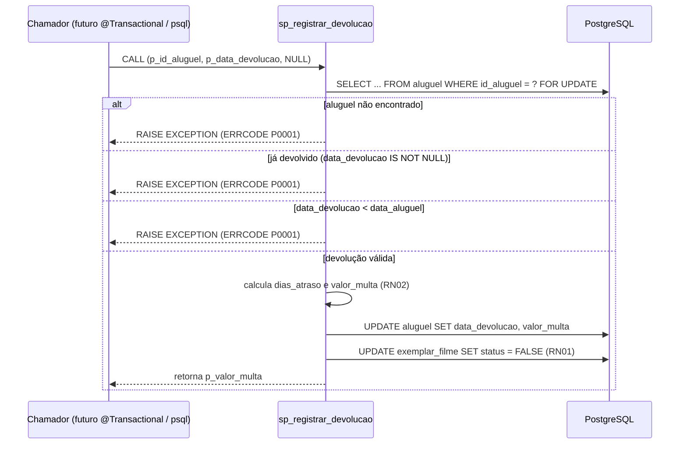

# Programação em Banco de Dados — como a Locadora conversa com o PostgreSQL

> Documento vivo: o Claude Code atualiza este arquivo a cada tarefa que toca o banco
> (skill `roteiro-bd2`). É o guia da apresentação: cada seção mostra **onde está no
> código** e **qual SQL é executado**.

## Sumário

1. [Checklist do roteiro](#1-checklist-do-roteiro)
2. [Conexão com a base](#2-conexão-com-a-base)
3. [Migrations (Flyway)](#3-migrations-flyway)
4. [Mapa de abstrações: do Java ao SQL](#4-mapa-de-abstrações-do-java-ao-sql)
5. [Transações](#5-transações)
6. [Stored procedure](#6-stored-procedure)
7. [Consultas com junção](#7-consultas-com-junção)
8. [Como ver o SQL gerado ao vivo](#8-como-ver-o-sql-gerado-ao-vivo)

## 1. Checklist do roteiro

| Item | Onde | Marca no código |
|---|---|---|
| 1c Conexão | _a preencher_ | `[ROTEIRO-1c-CONEXAO]` |
| 1c Consultas e procedures | _a preencher_ | `[ROTEIRO-1c-CONSULTA]`, `[ROTEIRO-1c-PROCEDURE]` |
| 2a Transações | _a preencher_ | `[ROTEIRO-2a-TRANSACAO]` |
| 2b Junção | _a preencher_ | `[ROTEIRO-2b-JUNCAO]` |
| 2c Stored procedure com parâmetro | _a preencher_ | `[ROTEIRO-2c-PROCEDURE]` |
| 2d SELECT / INSERT / UPDATE / DELETE | _a preencher_ | `[ROTEIRO-2d-*]` |
| Mapeamento do framework | seção 4 | `[ROTEIRO-FW-MAPEAMENTO]` |

Para listar todos os pontos: `grep -rn "\[ROTEIRO" backend/ docker-compose.yml`

## 2. Conexão com a base

_a preencher na Fase 2_

## 3. Migrations (Flyway)

| Versão | Arquivo | O que faz |
|---|---|---|
| V1 | `backend/src/main/resources/db/migration/V1__schema_bd1.sql` | Recria o schema original do BD1: 6 tabelas e 6 FKs, sem alterações. |
| V2 | `backend/src/main/resources/db/migration/V2__ajustes_bd2.sql` | Ajustes do BD2: `senha` em BCrypt (`VARCHAR(100)`), coluna `perfil` (ADMIN/ATENDENTE), `aluguel.data_devolucao`, CHECKs de RN04, índices em todas as FKs, `ON DELETE CASCADE` só em `filme_ator`, comentário em `exemplar_filme.status`. |
| V3 | `backend/src/main/resources/db/migration/V3__procedures.sql` | Stored procedure `sp_registrar_devolucao` (RF08, RN02): devolução + cálculo de multa, atômica, com `SELECT ... FOR UPDATE`. |
| R\_\_ (repeatable, só perfil `dev`) | `db/seed/R__dados_demo.sql` | Dados de demonstração do BD1 + 2 funcionários com senha em BCrypt via `pgcrypto`. Idempotente (`TRUNCATE ... RESTART IDENTITY CASCADE`). |

## 4. Mapa de abstrações: do Java ao SQL

| Método / anotação | Arquivo | SQL executado (copiado do log) | Roteiro |
|---|---|---|---|

## 5. Transações

## 6. Stored procedure

`sp_registrar_devolucao` implementa RF08 (registrar devolução) e atende o item 2c do
roteiro (stored procedure com parâmetro). Definida em
`backend/src/main/resources/db/migration/V3__procedures.sql`.

**Assinatura:**

```sql
CREATE OR REPLACE PROCEDURE sp_registrar_devolucao(
    IN    p_id_aluguel     INT,
    IN    p_data_devolucao DATE,
    INOUT p_valor_multa    NUMERIC
)
```

| Parâmetro | Direção | Significado |
|---|---|---|
| `p_id_aluguel` | IN | Aluguel a ser devolvido. |
| `p_data_devolucao` | IN | Data em que o cliente devolveu o exemplar. |
| `p_valor_multa` | INOUT | Entra vazio; a procedure calcula e devolve o valor da multa. |

**Regra de multa (RN02):** `dias_atraso = GREATEST(0, p_data_devolucao - data_entrega)`;
`valor_multa = dias_atraso × R$ 2,00`. Sem atraso, multa é `0`.

**Fluxo (transação atômica):**



**Erros:** todos os caminhos de regra de negócio usam `RAISE EXCEPTION ... USING ERRCODE
= 'P0001'` (aluguel inexistente, já devolvido, ou data de devolução anterior à do
aluguel — essa última guarda evita que o CHECK `ck_aluguel_devolucao_data` do V2
devolva um SQLSTATE diferente). Na Fase 4b, o Java converte `P0001` em HTTP 422.

**Por que é chamada assim:** sem `COMMIT` interno, pois a procedure roda dentro da
transação do chamador (o futuro service `@Transactional`); o `SELECT ... FOR UPDATE`
trava a linha do aluguel contra devolução concorrente do mesmo registro. Também pode
ser testada isoladamente via `psql` (`CALL sp_registrar_devolucao(2, '2026-06-20',
NULL);`), já que cada `CALL` de topo no `psql` autocommita.

## 7. Consultas com junção

## 8. Como ver o SQL gerado ao vivo
