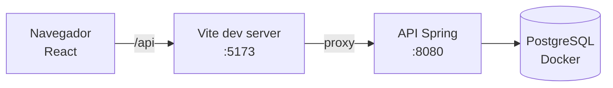

# Locadora de Filmes — Frontend

Interface web do sistema de locadora: React 19 + Vite + TypeScript, responsiva de 320 px a 1920 px.


## Sumário

- [Visão geral](#visão-geral)
- [Pré-requisitos](#pré-requisitos)
- [Início rápido](#início-rápido)
- [Como usar](#como-usar)
- [Estrutura de pastas](#estrutura-de-pastas)
- [Telas e rotas](#telas-e-rotas)
- [Identidade visual](#identidade-visual)
- [Solução de problemas](#solução-de-problemas)

## Visão geral

- Login por email e senha, com sessão em cookie (o JavaScript nunca vê a senha nem o cookie de sessão).
- Menu lateral no desktop; no celular vira um menu recolhível (drawer) aberto pelo botão **Menu**.
- Os itens do menu mudam conforme o perfil (`ATENDENTE` ou `ADMIN`).
- Erros do backend (`ProblemDetail`) aparecem no campo certo do formulário.



## Pré-requisitos

| Ferramenta | Versão | Como verificar |
|---|---|---|
| Node.js | 22 ou mais novo | `node -v` |
| npm | 10 ou mais novo | `npm -v` |
| Backend rodando | porta 8080 | `curl http://localhost:8080/api/auth/csrf` deve responder `204` |

## Início rápido

1. Suba o banco e o backend (na raiz do projeto, veja `docs/BANCO_DE_DADOS.md`).
2. Instale as dependências:

   ```bash
   cd frontend
   npm install
   ```

3. Inicie o servidor de desenvolvimento:

   ```bash
   npm run dev
   ```

   Você deve ver `Local: http://localhost:5173/`.

4. Abra `http://localhost:5173`. Sem sessão, você cai na tela de login.

Outros comandos:

```bash
npm run build   # confere os tipos e gera dist/
npm run lint    # oxlint
```

## Como usar

Usuários de demonstração (**só para desenvolvimento**):

| Perfil | Email | Senha |
|---|---|---|
| ADMIN | `carlos@locadora.com` | `admin123` |
| ATENDENTE | `fernanda@locadora.com` | `func123` |

> [!TIP]
> Para conferir a responsividade, abra o DevTools (`F12`), ligue o ícone de dispositivo e teste
> 360, 768, 1024 e 1440 px, em retrato e paisagem. A página nunca deve rolar na horizontal.

## Estrutura de pastas

```text
src/
├── api/          http.ts (fetch + CSRF + 401), problem.ts (ProblemDetail), formErrors.ts
├── auth/         sessão: authApi, useUsuario, guardas de rota, menu por perfil
├── components/   base responsiva: Container, Grid, Stack, DataTable, Form, Field, Button…
├── layout/       AppShell (menu lateral ↔ drawer) e MenuLateral
├── pages/        telas: Login, Perfil, Sem permissão, Não encontrada
├── styles/       tokens.css (design tokens), breakpoints.css/.ts, global.css
├── router.tsx    rotas
└── main.tsx      ponto de entrada
```

## Telas e rotas

| Rota | Perfil | Situação |
|---|---|---|
| `/login` | público | pronta |
| `/perfil` | todos | pronta |
| `/alugueis/novo`, `/devolucoes`, `/historico`, `/clientes`, `/filmes`, `/atores` | ATENDENTE e ADMIN | reservada (Fase 6b) |
| `/funcionarios`, `/relatorios` | ADMIN | reservada (Fase 6b) |

A tela de quem não tem permissão é só conveniência: **o backend é a barreira real**.

## Identidade visual

Direção **Acervo**: papel frio, tinta verde-escura, ação em azul-petróleo; âmbar só para atraso e multa.
Títulos em Newsreader, interface em Atkinson Hyperlegible Next (distingue `0`/`O` e `1`/`l` em códigos).
O único ornamento é a tira de perfurações de película no menu e no login.

- Cores, tipos (escala fluida com `clamp()`), espaços e formas: `src/styles/tokens.css`.
- Breakpoints (mobile-first, sempre `min-width`): `src/styles/breakpoints.css` — `--sm` 640, `--md` 768,
  `--lg` 1024, `--xl` 1280. Use `@media (--md) { … }` em qualquer CSS Module.

## Solução de problemas

<details>
<summary>O login responde 403 ("Token CSRF ausente ou inválido")</summary>

O cliente HTTP lê o cookie `XSRF-TOKEN` e o reenvia no header `X-XSRF-TOKEN`. Isso só funciona
com o app e a API na **mesma origem**: acesse por `http://localhost:5173` (proxy do Vite) e não
chame a porta 8080 direto do navegador.
</details>

<details>
<summary>Erro de proxy (`ECONNREFUSED`) no terminal do Vite</summary>

O backend não está rodando na porta 8080. Suba-o antes (`./mvnw -q spring-boot:run -Dspring-boot.run.profiles=dev`).
</details>

<details>
<summary>Caí no login com "Sua sessão terminou"</summary>

A sessão expirou ou a conta mudou de perfil. Entre de novo: você volta para a tela em que estava.
</details>
