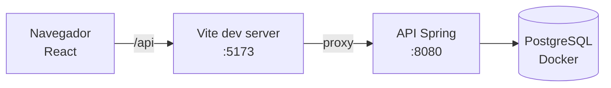

# Locadora de Filmes — Frontend

Interface web do sistema de locadora: React 19 + Vite + TypeScript, responsiva de 320 px a 1920 px.


## Sumário

- [Visão geral](#visão-geral)
- [Pré-requisitos](#pré-requisitos)
- [Início rápido](#início-rápido)
- [Configuração](#configuração)
- [Como usar](#como-usar)
- [Estrutura de pastas](#estrutura-de-pastas)
- [Telas e rotas](#telas-e-rotas)
- [Identidade visual](#identidade-visual)
- [Solução de problemas](#solução-de-problemas)
- [Autores](#autores)

## Visão geral

- Login por email e senha, com sessão em cookie (o JavaScript nunca vê a senha nem o cookie de sessão).
- Menu lateral no desktop; no celular vira um menu recolhível (drawer) aberto pelo botão **Menu**.
- Os itens do menu mudam conforme o perfil (`ATENDENTE` ou `ADMIN`).
- Erros do backend (`ProblemDetail`) aparecem no campo certo do formulário.



## Pré-requisitos

| Ferramenta | Versão | Como verificar |
|---|---|---|
| Node.js | 22 ou mais novo | `node -v` |
| npm | 10 ou mais novo | `npm -v` |
| Backend rodando | porta 8080 | `curl http://localhost:8080/api/auth/csrf` deve responder `204` |

## Início rápido

> [!TIP]
> Só quer **usar** o sistema? Não precisa deste README: `docker compose --profile app up -d --build`
> sobe tudo (inclusive este frontend, já compilado) em <http://localhost:8080>. Veja o
> [README da raiz](../README.md).

Para **desenvolver** o frontend:

1. Suba o banco e o backend em modo dev (passos em [`backend/README.md`](../backend/README.md#início-rápido)).
2. Instale as dependências:

   ```bash
   cd frontend
   npm install
   ```

3. Inicie o servidor de desenvolvimento:

   ```bash
   npm run dev
   ```

   Você deve ver `Local: http://localhost:5173/`.

4. Abra `http://localhost:5173`. Sem sessão, você cai na tela de login.

Outros comandos:

```bash
npm run build   # confere os tipos e gera dist/
npm run lint    # oxlint
```

## Configuração

O frontend não tem variáveis de ambiente. O único ajuste é o proxy do Vite
(`vite.config.ts`): em dev, `/api` é repassado para `http://localhost:8080`. Assim o navegador
fala com uma origem só, e os cookies de sessão e `XSRF-TOKEN` funcionam sem CORS.

No modo Docker não há Vite: o `npm run build` roda dentro do `backend/Dockerfile`, o resultado
vira recurso estático do jar e o Spring (`SpaConfig`) o serve na mesma origem da API.

## Como usar

Usuários de demonstração (**só para desenvolvimento**):

| Perfil | Email | Senha |
|---|---|---|
| ADMIN | `carlos@locadora.com` | `admin123` |
| ATENDENTE | `fernanda@locadora.com` | `func123` |

> [!TIP]
> Para conferir a responsividade, abra o DevTools (`F12`), ligue o ícone de dispositivo e teste
> 360, 768, 1024 e 1440 px, em retrato e paisagem. A página nunca deve rolar na horizontal.

## Estrutura de pastas

```text
src/
├── api/
│   ├── http.ts, problem.ts, formErrors.ts   fetch + CSRF + 401, ProblemDetail, erros nos formulários
│   ├── recurso.ts                           fábrica do CRUD padrão (lista, um, salvar, excluir)
│   ├── tipos.ts                             DTOs do backend
│   └── recursos/                            cadastros, filmeDetalhe, alugueis, relatorios
├── auth/         sessão: authApi, useUsuario, usePode, guardas de rota, menu por perfil
├── components/   base responsiva: Container, Grid, Stack, DataTable, Form, Field, Button,
│                 Dialogo, ConfirmDialog, ListaPagina, SearchBox, Paginacao, Etapas, Etiqueta…
├── layout/       AppShell (menu lateral ↔ drawer) e MenuLateral
├── lib/          formato.ts (dinheiro, datas, telefone), useListaUrl.ts (busca/página na URL)
├── pages/        uma pasta por assunto: aluguel, clientes, filmes, atores, funcionarios, relatorios
├── styles/       tokens.css (design tokens), breakpoints.css/.ts, global.css
├── router.tsx    rotas (cada tela carrega sob demanda)
└── main.tsx      ponto de entrada
```

## Telas e rotas

| Rota | Perfil | O que faz | Requisito |
|---|---|---|---|
| `/login` | público | entrar com email e senha | RF01 |
| `/perfil` | todos | dados da conta e sair | RF01 |
| `/alugueis/novo` | ATENDENTE, ADMIN | aluguel em 4 etapas: filme → exemplar disponível → cliente → confirmação | RF07, RF09 |
| `/devolucoes` | ATENDENTE, ADMIN | aluguéis em aberto; registrar devolução e ver a multa calculada pelo banco | RF08 |
| `/historico` | ATENDENTE, ADMIN | histórico com filtro por cliente e "só em aberto" | RF10 |
| `/clientes`, `/clientes/novo`, `/clientes/:id` | ATENDENTE, ADMIN (excluir: ADMIN) | lista com busca, cadastro e edição | RF05 |
| `/filmes`, `/filmes/:id` | ATENDENTE, ADMIN | lista com busca; detalhe com exemplares, disponibilidade e elenco | RF02, RF03, RF04, RF09 |
| `/filmes/novo`, `/filmes/:id/editar` | ADMIN | cadastro e edição de filme; no detalhe: exemplares e elenco | RF02, RF03, RF04 |
| `/atores` | ATENDENTE, ADMIN | lista com busca | RF03 |
| `/atores/novo`, `/atores/:id` | ADMIN | cadastro e edição | RF03 |
| `/funcionarios`, `/funcionarios/novo`, `/funcionarios/:id` | ADMIN | lista com busca, cadastro e edição (perfil, senha) | RF06 |
| `/relatorios` | ADMIN | faturamento por funcionário, exemplares por filme, filmes com mais de um ator | RF11 |

Quem não tem o perfil vê "Sem permissão", e os botões que não pode usar nem aparecem.
Isso é só conveniência: **o backend é a barreira real**.

> [!NOTE]
> A multa **não** é calculada no navegador. A tela de devolução mostra o valor devolvido pela
> stored procedure `sp_registrar_devolucao`; antes de confirmar, exibe só o atraso previsto em dias.

## Identidade visual

Direção **Acervo**: papel frio, tinta verde-escura, ação em azul-petróleo; âmbar só para atraso e multa.
Títulos em Newsreader, interface em Atkinson Hyperlegible Next (distingue `0`/`O` e `1`/`l` em códigos).
O único ornamento é a tira de perfurações de película no menu e no login.

- Cores, tipos (escala fluida com `clamp()`), espaços e formas: `src/styles/tokens.css`.
- Breakpoints (mobile-first, sempre `min-width`): `src/styles/breakpoints.css` — `--sm` 640, `--md` 768,
  `--lg` 1024, `--xl` 1280. Use `@media (--md) { … }` em qualquer CSS Module.

## Solução de problemas

<details>
<summary>O login responde 403 ("Token CSRF ausente ou inválido")</summary>

O cliente HTTP lê o cookie `XSRF-TOKEN` e o reenvia no header `X-XSRF-TOKEN`. Isso só funciona
com o app e a API na **mesma origem**: acesse por `http://localhost:5173` (proxy do Vite) e não
chame a porta 8080 direto do navegador.
</details>

<details>
<summary>Erro de proxy (`ECONNREFUSED`) no terminal do Vite</summary>

O backend não está rodando na porta 8080. Suba-o antes (`./mvnw -q spring-boot:run -Dspring-boot.run.profiles=dev`).
</details>

<details>
<summary>Caí no login com "Sua sessão terminou"</summary>

A sessão expirou ou a conta mudou de perfil. Entre de novo: você volta para a tela em que estava.
</details>

## Autores

- João Marcos Campelo
- Vitor Fagundes
- Isabella Baracho
- Catarina Cotta Lannes
- Dayvid Eduardo
